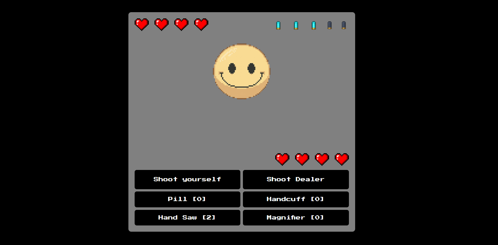

# Buckshot Roulette



### Game Description

**Buckshot Roulette** is a turn-based strategy and probability game against an AI Dealer. At the start of each reload, you must memorize the number of **live** and **empty (blank)** shells loaded into the chamber—without knowing their exact order. Your goal is to outsmart the Dealer and reduce their health to **0 hearts** before they eliminate you.

On each turn, you have two main moves:
- **Shoot Yourself:** Risk pulling the trigger on yourself. If it is a blank shell, you survive and earn another turn to decide your next move.
- **Shoot the Dealer:** Aim at the Dealer, hoping the next shell in the chamber is live to deal damage.

Both you and the Dealer are given strategic items on each reload—manage your odds and use your items smarter than your opponent to win.

---

### How to Play

1. **Starting Health:** Both the Player and the Dealer begin with **4 hearts**.
2. **Loading the Chamber:** Between **3 and 8 shells** are randomly loaded into the chamber. The total count of live and empty shells is briefly shown at the start of each round, then hidden.
3. **Taking Your Turn:**
   - Use any available items from your inventory before firing.
   - Choose **Shoot Dealer** or **Shoot Player**.
   - Shooting yourself with a **blank** keeps your turn active; shooting the Dealer or hitting yourself with a **live** shell passes the turn (unless Handcuffs are active).
4. **The Dealer's:** On the Dealer's turn, the calculates the probability of live vs. blank shells remaining and strategically uses its own items before deciding who to shoot.
5. **Winning the Game:** The first side to drop their opponent to **0 hearts** wins the match.

---

### Items

Each time the chamber reloads, both the Player and the Dealer receive random items:

| Item | Effect |
| :--- | :--- |
| **Pill** | Restores **1 heart** (up to a maximum of 4 hearts). |
| **Magnifier** | Lets you inspect the chamber to see whether the **current shell** is live or blank. |
| **Hand Saw** | Doubles the damage of the next live shot (**2 hearts** instead of 1). |
| **Handcuff** | Restrains the opponent, skipping their next turn and giving you an extra turn. |

---

### Getting Started

#### Play Online
Open up [this link](https://hahasdev.github.io/Buckshot-Roulette/) to play directly in your browser.


### Technologies Used

- **HTML5** – Structure, modals, and audio elements
- **CSS3** – Layout, styling, and heart/UI states
- **JavaScript** – Game loop, async animations, probability-based Dealer, and DOM manipulation

---

### Project Structure


buckshot-roulette/
├── assets/             # Dealer sprites, shell graphics, heart icon, sound effects, and favicons
├── css/
│   └── style.css       # Game styling and layout
├── app.js              # Core game logic, item effects, animations, and Dealer AI
├── index.html          # Main game interface and instructions modal
└── README.md           # Project documentation
```

---

### Credits

- **Game Inspiration:** Inspired by *Buckshot Roulette* by Mike Klubnika.
- **Dealer Sprites & Animations:** Animated dealer artwork created/sourced from Gemini and chatGPT.
- **Sound Effects:** Live and empty shell audio sourced from *[https://pixabay.com/sound-effects/search/shotgun/]*.
- **Favicon:** Generated using [Favicon.io](https://favicon.io/).
- **References:** [MDN Web Docs](https://developer.mozilla.org/) (Async/Await & DOM APIs) and [Stack Overflow](https://stackoverflow.com/).

---

### Future Enhancements

- Add an on-screen win/loss modal with a **Play Again** button so the game can be restarted without refreshing the page.
- Add a sound toggle button to mute/unmute audio effects.
- Display the Dealer's current inventory on screen so the player can plan around the Dealer's items.
- Add multiple rounds or difficulty modes with escalating health and item pools.